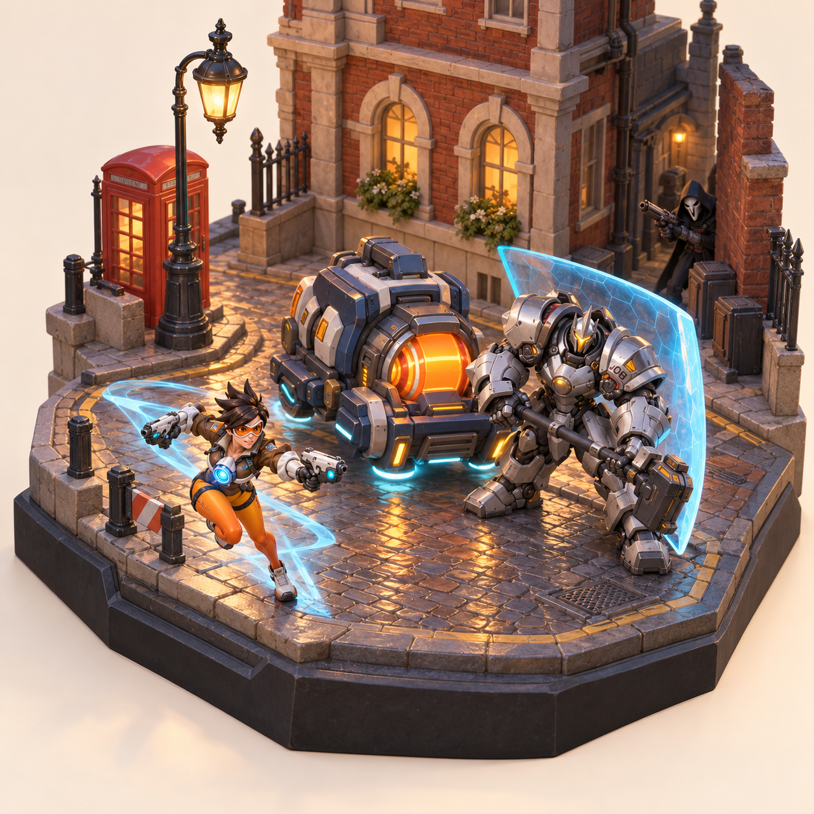

# 守望先锋微缩场景

国王大道护送主题的卡通微缩场景资产资料库。

角色生成输入：[带动作的三位角色 · 15 张独立视图](design/characters-posed/README.md) · [本地角色图册](design/characters-posed/index.html)。猎空冲刺、莱因哈特持锤防守、死神双枪戒备，可用于混元 3D 图生模型。

新增：[18 件单体四视图造型参考](design/assets-turnarounds/README.md) · [本地浏览图册](design/assets-turnarounds/index.html)。每张图板单独展示一件资产，包含正面、右侧、背面和顶面，用于下一轮精细建模。

## 运行交互作品

下载并双击 [overwatch-diorama.html](overwatch-diorama.html)。所有运行代码、几何、材质和图标已内嵌，可离线运行。

- 拖动旋转，滚轮缩放；顶部按钮切换展示、正面、顶面、右侧、背面。
- 点击路灯、壁灯、电话亭或房间窗户直接开关；“灯光控制”面板可以选择七个分区，设置自动 / 常亮 / 关闭和亮度。
- 底部调时间或播放一天的光影；手动灯光状态不受时间切换覆盖。
- 房间在侧面、背面的窗户与其正面窗户同步。实墙会阻挡点选，被遮挡对象仍可通过列表控制。
- 单文件中的场景与三位角色是原创程序化几何重建，没有嵌入下载的游戏模型或远程资源。造型遵循布局与卡通方向，与概念图的细节精度有差异。

### 构建与验证

```sh
npm ci
npm test
npm run build
```

依赖版本保存在 package-lock.json。`web/` 包含界面、状态模型、三维场景与单文件封装源码；开发时的 npm 依赖不会成为成品 HTML 的外部依赖。

浏览器验收脚本为 `tools/test_html.py`，需要 Playwright Python 及 Chromium / Firefox。HTTP 打开方式的验收需要另启动本机测试服务器：

```sh
python3 -m http.server 8765 --bind 127.0.0.1
python3 tools/test_html.py --soak 600
```

测试脚本会另行用 `file://`、断网模式验证 HTML，并在 `docs/validation/` 保存截图和报告。主流显卡与移动实机的性能须另做设备实测；云端软件渲染和缩小窗口不能替代这些测试。

新增：[四方向视觉参考与固定坐标布局](design/README.md) · [按图匹配的资产清单](assets/catalog/四视图资产匹配.md)。

制作基线：[单文件交互 HTML 制作执行标准 v1.0](docs/制作执行标准-v1.md)，包含灯光/房间交互、时间系统、性能预算和验收清单。



## 已放入仓库

- 本次生成的概念图 PNG；它是二维设计参考，不是可编辑的三维模型。
- [推荐资产与使用说明](assets/catalog/资产清单.md)：护送车、国王大道道具包、猎空、莱因哈特、死神等。
- [Steam 资产目录](assets/catalog/steam-assets.json)：9 个已读取详情的模型包/场景条目。
- [Sketchfab 检索目录](assets/catalog/sketchfab-candidates.json)：64 个去重后的搜索候选，包含未采用或不相关的结果，不表示全部适合本项目。
- 官方来源获取工具，可查询 Steam 模型文件信息并下载到独立的本地素材库。

## 模型文件状态

**本仓库当前没有上述第三方模型的二进制文件。**公开下载链接并不等同于允许把文件重新发布到公开 GitHub 仓库。死神和另一版莱因哈特的作者明确禁止未经许可再次分发；其余 Steam 条目的再次分发许可尚未核实。Sketchfab 下载需要账号授权，本次未获取模型文件。

这些社区移植模型的原始角色、模型与贴图权利归原权利人；目录不授予额外使用权。Kenney City Kit (Commercial) 也曾作为通用场景备选查阅：[官方来源](https://kenney.nl/assets/city-kit-commercial)，页面标注 CC0，本仓库未收录其压缩包。

## 从官方来源获取本地模型

只查询信息，不下载：

```sh
python3 tools/fetch_steam_asset.py --id 1388222994
```

从 Steam 官方文件接口下载到独立目录：

```sh
python3 tools/fetch_steam_asset.py --id 1388222994 --download --output /workspace/model-library
```

批量获取本项目主要条目：

```sh
python3 tools/fetch_steam_asset.py \
  --id 1388222994 --id 685994386 --id 685956699 \
  --id 805261541 --id 805261856 --id 740614996 \
  --download --output /workspace/model-library
```

脚本保留系统代理和 TLS 校验；不会修改模型，不会上传下载文件，不会保存临时下载地址。下载后应自行检查源文件使用条款。旧条目可能失效，脚本会明确报错，不使用非官方镜像替代。

以上主要是 SFM/Source `.mdl` 文件；需要先验证 Blender 导入、贴图和骨骼，再按需导出 FBX 给 Cascadeur。当前没有执行模型转换或验证动画兼容性。

## 检索记录

2026-10-30 使用用户上传的 Scrapling skill（Scrapling 0.5）检索公开目录。Steam 官方文件详情接口已成功返回六个主要条目的文件元数据及下载地址。

获取脚本已实际下载并核对一份《守望先锋 2》猎空文件：89,982,682 字节，SHA256 `622c7989dbbe4b7fd08051078b6db34ee26780d944d11debe65ea27a35413d13`。该文件仅保存在当前云环境的 `/workspace/model-library/`，未放入 GitHub 仓库，未验证导入和骨骼兼容。作者说明与实际导入结果可能存在差异。
