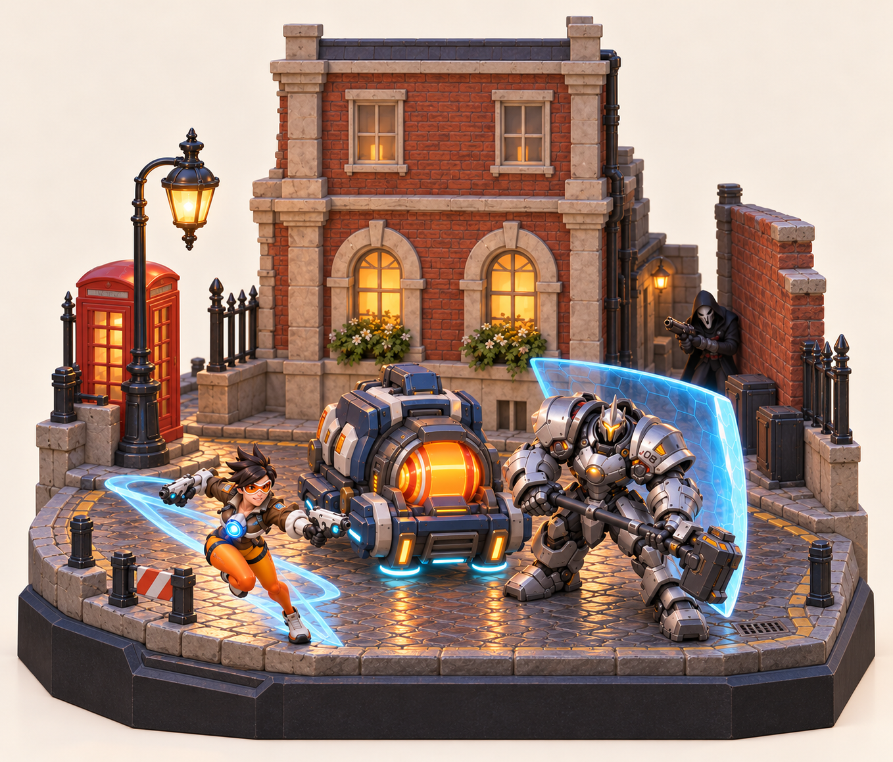
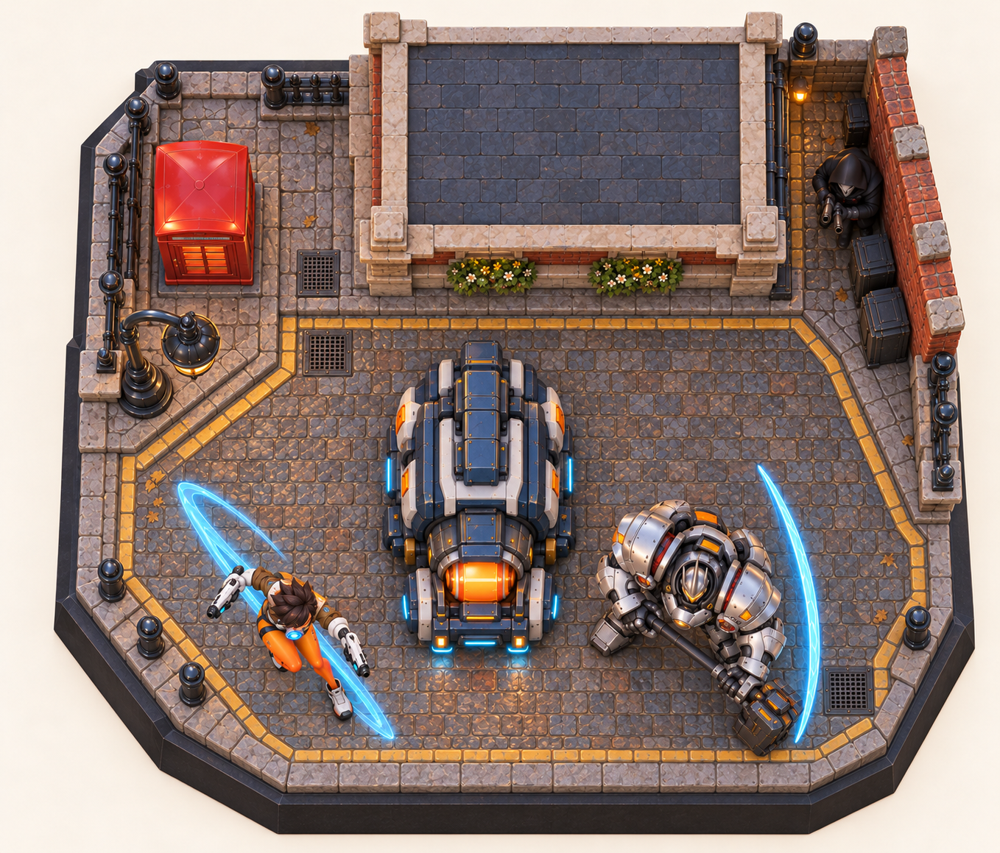
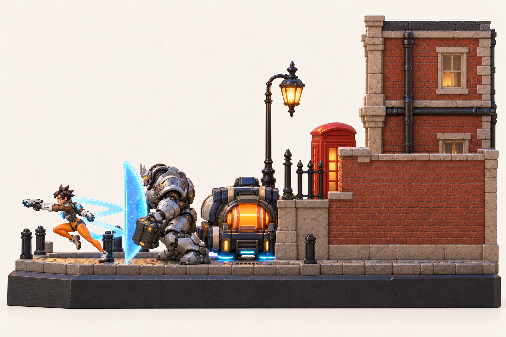
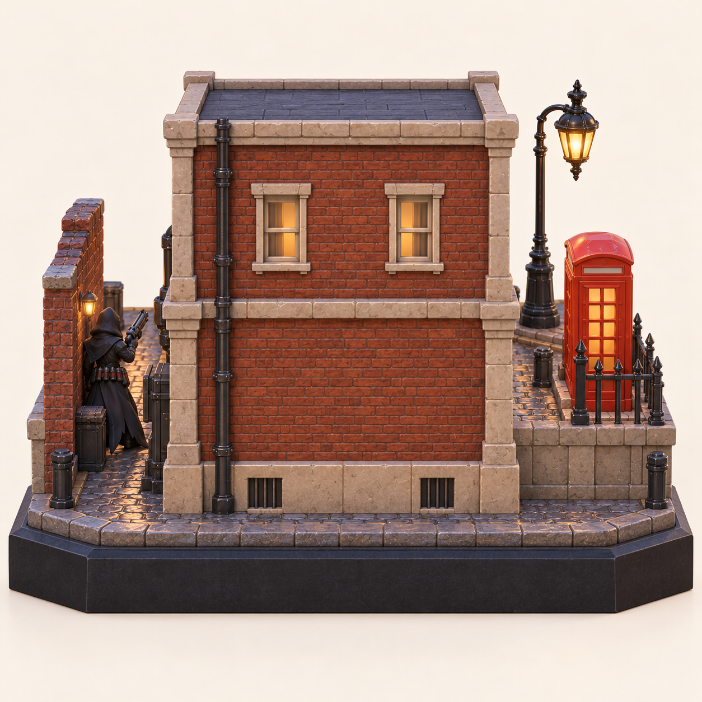
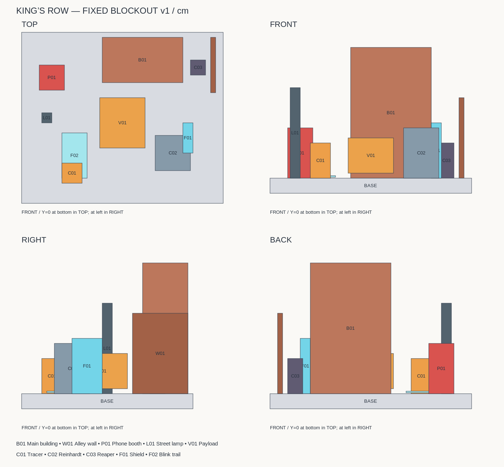

# 国王大道微缩场景：空间方案 v1

## 四方向视觉参考

| 正面 | 顶面 |
| --- | --- |
|  |  |
| **右侧面** | **背面** |
|  |  |

这四张是基于同一布局要求生成的视觉参考，并非同一个三维模型的四相机渲染。校正后的顶面和侧面仍存在透视与细节差异，例如护送车朝向、人物动作和护盾形状；不可直接据图片像素测量或进行四视图几何重建。

## 用于搭建的固定空间

物件位置、尺寸、遮挡和左右方向以 [layout-v1.json](layout-v1.json) 为准。[正投影占位图 PNG](layout-v1.png) / [可缩放 SVG](layout-v1.svg) 的四个投影均由同一组方盒坐标计算，避免生成图片的布局漂移。这些方盒只定义占地和高度，不代表最终模型轮廓。

- 单位为厘米，底座宽 40、深 34、厚 3；尺寸是本方案设计值，不是游戏官方尺寸或最终打印规格。
- X 向正面观察者的右侧；Y 从前沿 0 指向后沿 34；Z 向上，地面为 0，底座向下到 -3。
- 主建筑：X=-4…12、Y=24…33，高 26；正面朝向 Y 的负方向。建筑主体封闭，背面不能为了露出英雄而删墙。
- 小巷右墙：X=17.5…18.5、Y=22…33，高 16。死神在建筑与墙之间。
- 电话亭中心 (-14,25)，路灯中心 (-15,17)。
- 护送车中心 (0,16)，长轴沿 Y，车头朝向前沿。
- 猎空中心 (-10,6)，莱因哈特中心 (10,10)，死神中心 (15,27)。三位角色都面向前沿。
- 护盾占位 X=12…14、Y=10…16，高 11；闪现轨迹沿猎空后方延伸。透明曲面最终轮廓需要建模时确定。

背视图左右方向与正视图相反：电话亭在画面右侧，小巷在画面左侧。右侧视图的前沿在画面左侧、后沿在画面右侧。被建筑或墙挡住的人物不移动。

下一步三维搭建应先导入或创建这些占位体，锁定相机，再替换模型并重建材质；最终严格对齐的成品四视图须从同一个三维场景渲染。

## 按图匹配资产

见 [四视图资产匹配表](../assets/catalog/四视图资产匹配.md)。现阶段已验证两个主要模型包的下载和 ZIP 完整性；尚未验证 Blender / Cascadeur 导入及模型外观。
