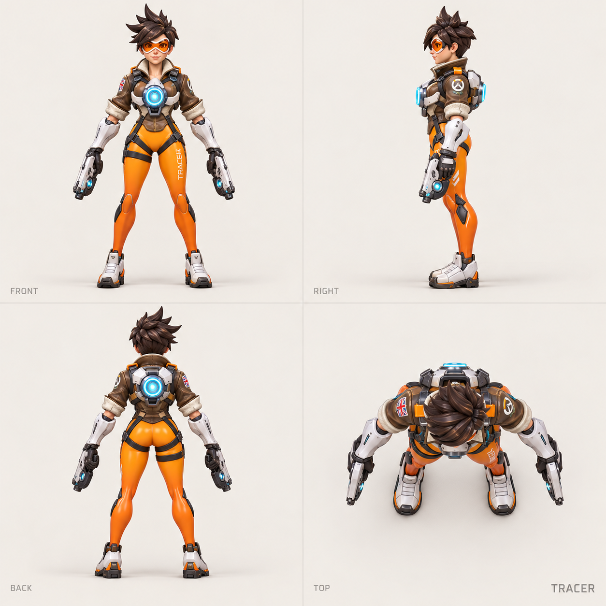
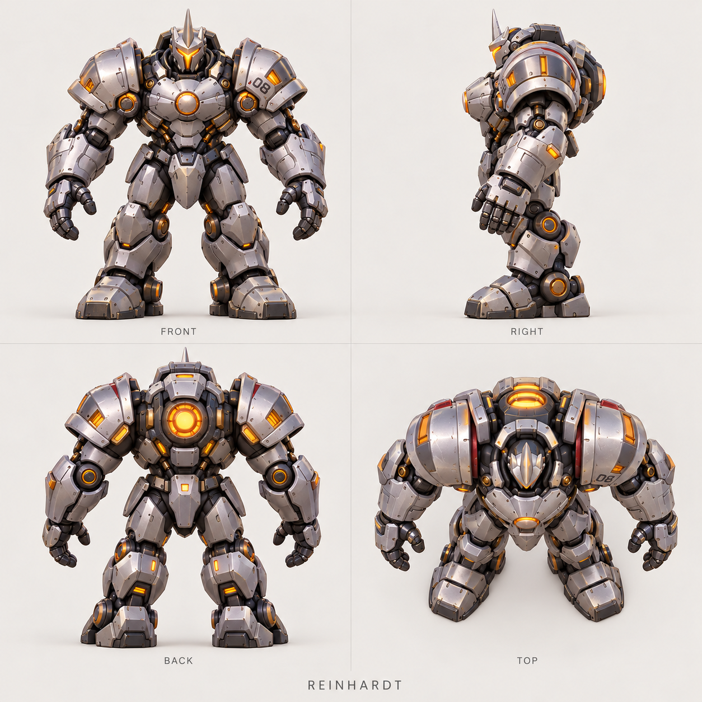
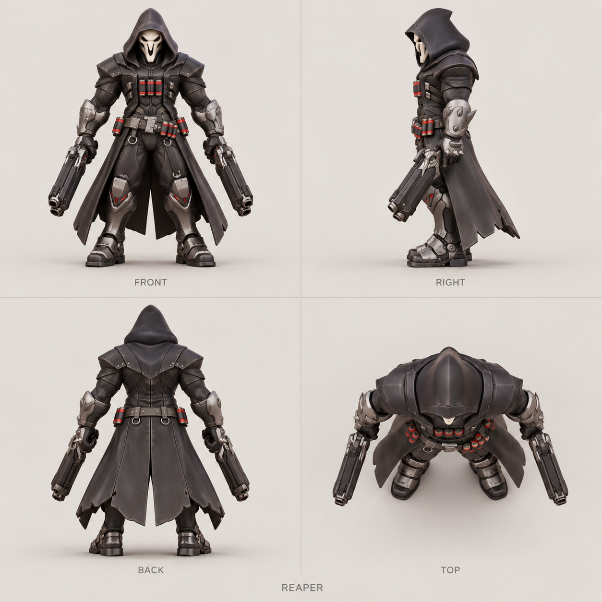
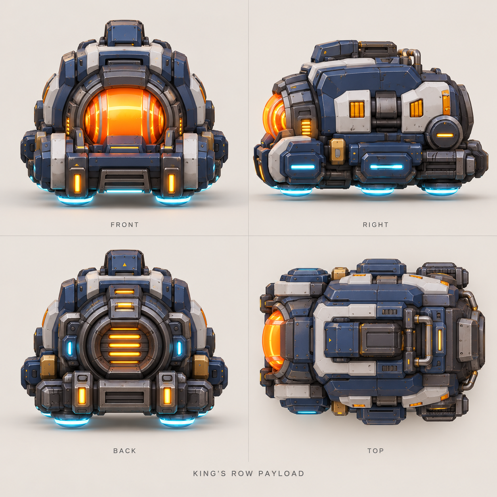
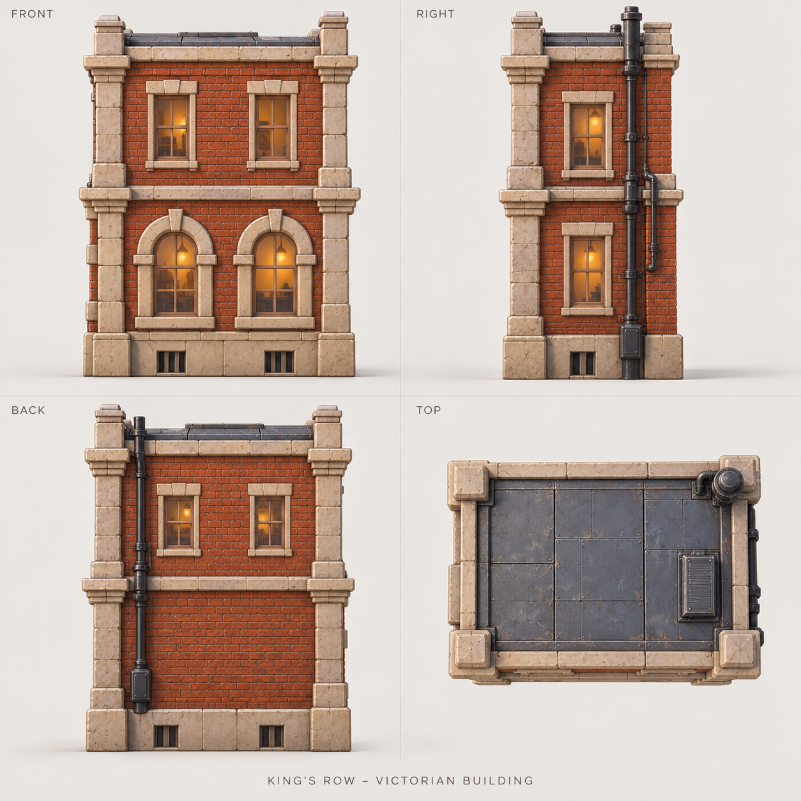
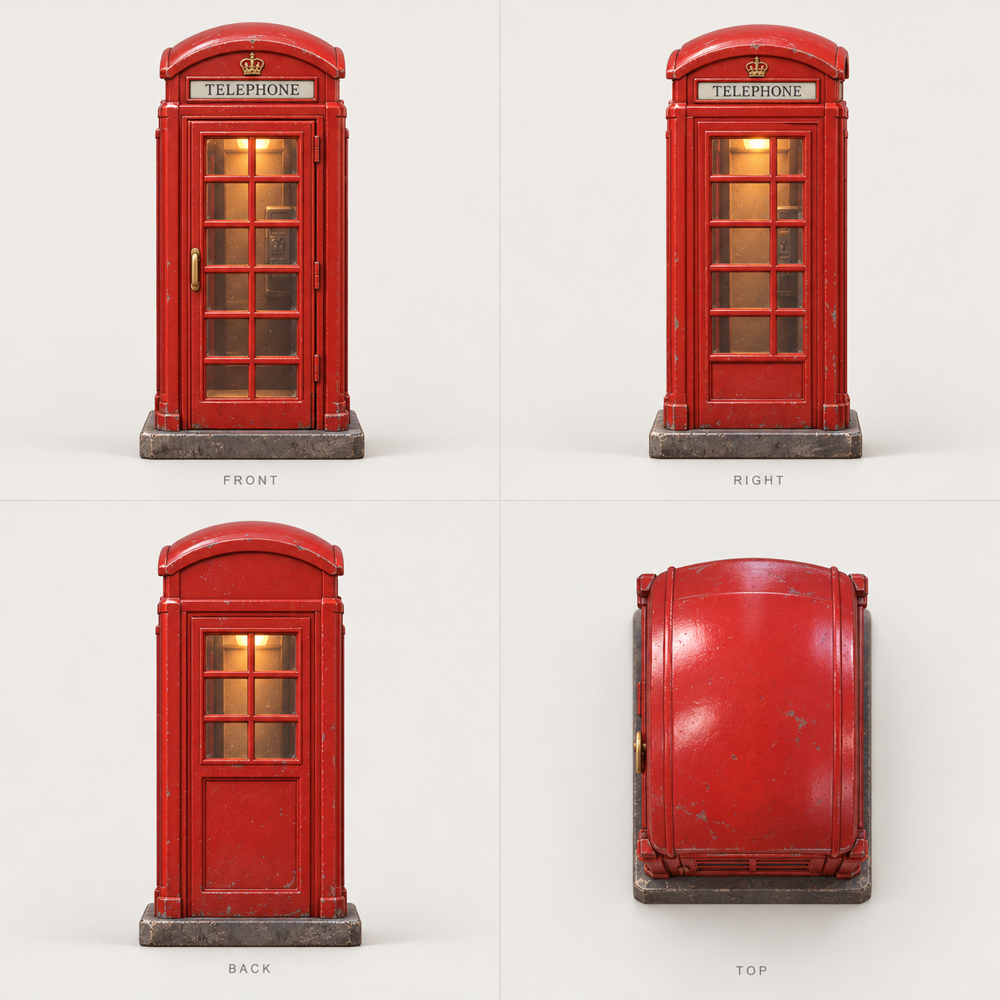

# 单体多视图造型参考 · 18 件资产

从原始国王大道概念图拆出的 18 张独立设计板，每张包含正面、右侧、背面、顶面，共 72 个视图面板。用于下一轮精细建模，不是当前简化 HTML 模型的截图。

打开 [本地浏览图册](index.html)，或点击下表查看原尺寸 PNG。

**角色图已更新为带动作版本：[三位角色的独立多视图与混元 3D 使用说明](../characters-posed/README.md)。生成场景角色时优先使用新版；本目录前三张保留作服装与装甲造型参考。**

## 使用方式

- 先定单体轮廓和层次，再做主结构、细节、材质；不要直接用几何方盒冒充角色或装甲成品。
- 本目录旧角色图采用观察站姿；新版角色已经包含场景动作，可直接作为图生模型输入。独立大锤与护盾参考仍保留在 15、16。
- 这些是生成式造型参考，不是同一个三维模型渲染出来的精密正投影图。部分顶图仍有俯视倾角，不同面板的接缝、装饰、投影和比例可能有差异。
- 建模时必须在同一个三维网格中统一轮廓；尺寸、占地与场景位置以 [layout-v1.json](../layout-v1.json) 为准，不能从图板像素推断厘米数。
- 护送车顶图、透明特效和街道底座尤其需要先确定朝向与曲线。两张灯具图已额外校正了明显重复的视角。
- 建筑窗户、电话亭玻璃和灯罩需要保留独立材质，供后续 HTML 的灯光交互使用。

## 资产目录

| 编号 | 单体 | 类别 | 场景 ID | 建模说明 |
| --- | --- | --- | --- | --- |
| 01 | [猎空](01-tracer.png) | 角色 | `C01` | 站姿造型与服装、加速器、双枪；场景中的冲刺姿态需另做绑定摆姿。 |
| 02 | [莱因哈特](02-reinhardt.png) | 角色 | `C02` | 装甲角色本体；大锤与护盾见 15、16，建模时保持独立。 |
| 03 | [死神](03-reaper.png) | 角色 | `C03` | 兜帽、面具、披风、腰带和双枪；注意背部披风分层。 |
| 04 | [护送车](04-payload.png) | 载具 | `V01` | 前部橙色核心、侧甲、顶部结构、后部散热；顶图方向需按车头对齐。 |
| 05 | [维多利亚式建筑](05-building.png) | 建筑 | `B01` | 封闭建筑、石材窗套、屋顶、背墙与排水管；下层拱窗、上层矩形窗。 |
| 06 | [红色电话亭](06-phone-booth.png) | 道具 | `P01` | 门、玻璃、框架和内部灯光拆分，保留可交互材质入口。 |
| 07 | [主路灯](07-street-lamp.png) | 道具 | `L01` | 已校正侧面与背面方向；灯柱、曲柄、灯罩和玻璃分别建模。 |
| 08 | [小巷砖墙](08-alley-wall.png) | 建筑 | `W01` | 砖墙、压顶与端柱；长宽高由场景布局统一，不能照图板像素定尺寸。 |
| 09 | [小巷壁灯](09-wall-lantern.png) | 道具 | `L02` | 已校正正、侧、背方向；壁板与弯支架必须有真实连接。 |
| 10 | [金属垃圾箱](10-metal-bin.png) | 道具 | `PROP_BIN` | 箱体、盖子、铰链和把手；作为巷内细节。 |
| 11 | [英式路桩](11-bollard.png) | 道具 | `PROP_BOLLARD` | 短柱、底板、顶帽和金属环；相同立面是旋转对称造型的表现。 |
| 12 | [铁艺围栏](12-fence.png) | 道具 | `PROP_FENCE` | 可重复拼接的栏杆模块；端柱、横梁和尖头分层。 |
| 13 | [窗台花箱](13-flower-box.png) | 道具 | `PROP_PLANTER` | 花箱与安装支架、叶片和花朵分别组织；不要逐像素复制植物。 |
| 14 | [红白路障](14-road-barrier.png) | 道具 | `PROP_BARRIER` | 红白挡板、固定件和两侧立柱，按底座前沿比例缩放。 |
| 15 | [火箭大锤](15-rocket-hammer.png) | 武器与特效 | `WEAPON_HAMMER` | 独立锤头、握柄、端帽与发光散热口，随后装配到角色手中。 |
| 16 | [能量护盾](16-energy-shield.png) | 武器与特效 | `F01` | 薄曲面、发光边与六边形纹理；顶图用于理解曲率，不按图中辉光推算厚度。 |
| 17 | [闪现轨迹](17-blink-trail.png) | 武器与特效 | `F02` | 连续透明曲带；最终应贴合猎空动作和既定路径，而非照搬图板中的竖直摆放。 |
| 18 | [空街道底座](18-street-base.png) | 底座 | `BASE` | 倒角底座、石板路、人行道、黄线和排水格栅；布局仍按 40×34 cm 设计坐标。 |

## 主要造型预览

| 猎空 | 莱因哈特 |
| --- | --- |
|  |  |
| **死神** | **护送车** |
|  |  |
| **建筑主体** | **电话亭** |
|  |  |

文件尺寸、哈希及对应 ID 见 [manifest.json](manifest.json)。
