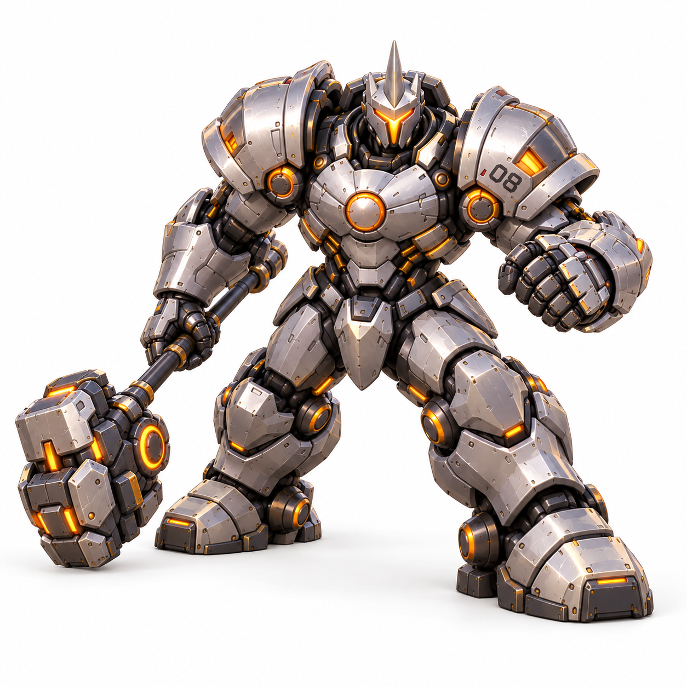

# 带动作角色图片 · 混元 3D 输入参考

三位角色均已摆成场景动作，包含武器；每位提供正面、左侧、右侧、背面及顶面补充图，共 15 张独立 PNG。无拼图、文字、场景和展示台，白色背景，便于逐张上传。生成日期：2026-10-31（北京时间）。

打开 [本地图册](index.html) 查看与下载原图。此批图片替代旧站姿图作为角色生成输入；当前 HTML 内的简化几何尚未替换。

## 角色与文件

| 角色 | 动作 | 主输入图 | 左侧 | 右侧 | 背面 | 顶面补充 |
| --- | --- | --- | --- | --- | --- | --- |
| 猎空 | 前倾冲刺，前腿弯曲、后腿伸展，双枪分置身体两侧 | [正面](tracer/front.png) | [左侧](tracer/left.png) | [右侧](tracer/right.png) | [背面](tracer/back.png) | [顶面](tracer/top.png) |
| 莱因哈特 | 宽步屈膝防守，右手持锤，左臂抬起戒备 | [正面](reinhardt/front.png) | [左侧](reinhardt/left.png) | [右侧](reinhardt/right.png) | [背面](reinhardt/back.png) | [顶面](reinhardt/top.png) |
| 死神 | 不对称战斗站姿，右手抬枪、左手低持枪，衣摆展开 | [正面](reaper/front.png) | [左侧](reaper/left.png) | [右侧](reaper/right.png) | [背面](reaper/back.png) | [顶面](reaper/top.png) |

左右按角色自身方向命名：左侧图通常朝画面左方，右侧图通常朝画面右方。部分侧图带有三分之四角度，顶图为俯视补充参考，不能当作精确正投影。

## 在混元 3D 中使用

1. **单图生成：**先上传对应角色的 `front.png`。使用单独的一张角色原图，不上传网页截图或多图拼接。
2. **多视图生成：**如果所用入口支持多视图，按其实际槽位添加正面、背面、左右侧。先核对平台对左右方向的定义；没有顶面槽位就不用上传顶图。
3. 同一次生成只输入同一角色、同一套动作图。旧版站姿图可供人工核对服装，避免与新版动作图混合输入。
4. 可填提示词的入口可使用下方文本；不支持提示词时直接上传图片即可。
5. 生成后重点检查手指与握柄连接、枪口数量、锤柄连续性、双腿间隙及披风内侧。确认模型姿态和贴图后，再导出所用版本支持的格式；后续网页整合优先提供带贴图的 GLB。

### 可选提示词

**猎空：**单个完整卡通微缩角色，保持参考图片中的前倾冲刺姿态、前后腿位置和双枪手势。棕色短发与飞行夹克、橙色护目镜及紧身裤、白色护臂和靴子、胸背蓝色圆形加速器。手臂与身体之间保留空间，双枪各由一只手握持，保留完整手脚。只生成角色和手持武器。

**莱因哈特：**单个完整重装骑士微缩角色，保持参考图中的宽步屈膝防守姿态，右手握住完整火箭大锤，左前臂抬起戒备。银灰色分层装甲、橙色面罩与散热口，盔甲体积厚重，锤柄连续，双脚稳定。护盾平面后续单独制作。只生成角色和手持大锤。

**死神：**单个完整卡通微缩角色，保持参考图中的不对称战斗站姿，右手抬枪、左手低持另一把枪。黑色兜帽和长外套、白色骷髅面具、银灰护臂及红色弹壳配件，保留衣摆分层和双腿间隙。两把枪各由一只手握持，保留完整手脚。只生成角色和手持双枪。

## 一致性与后续装配

这些图片以同一角色正面动作图为参考生成其他视角，但并非同一个真实网格的转台渲染。接缝、配件、手臂角度与比例仍可能漂移；正面主图作为动作和外观的首要依据，多图冲突时先尝试单图生成。尚未实际提交混元 3D，也未验证生成网格质量。

半透明护盾和闪现轨迹已从角色图中省去，避免遮挡；后续在网页中独立制作。大锤已出现在莱因哈特的手中，双枪也已出现在猎空、死神的手中。已有独立武器参考可用于修复细节。

角色在场景中的位置与缩放继续以 [layout-v1.json](../layout-v1.json) 为准，动作外伸的武器和披风需要装配时检查与护送车、墙体的碰撞。文件尺寸与 SHA256 见 [manifest.json](manifest.json)。

| 猎空 · 冲刺 | 莱因哈特 · 防守 | 死神 · 戒备 |
| --- | --- | --- |
|  |  |  |
